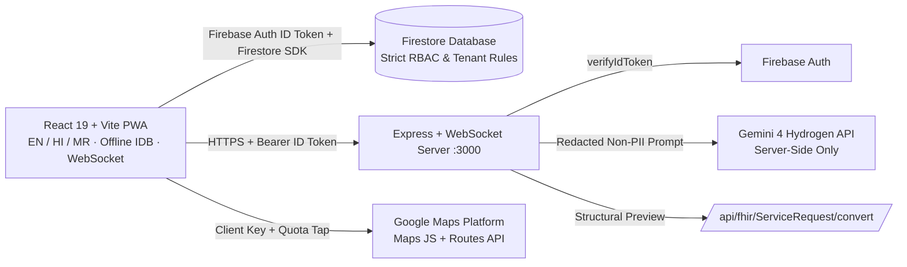

# RAKSHA Architecture, Threat Model & Operational Runbooks

> **Pilot Boundary**: RAKSHA is a coordination and healthcare navigation pilot platform for Maharashtra. It does not replace physicians, hospitals, or **108 / 112** emergency services, and is **not ABDM / NHCX certified**.

## 1. System Architecture

## 2. Tenant Isolation (`mh-live` vs `demo-maharashtra`)
- **`mh-live` (Live Pilot Tenant)**:
  - Public directory facilities carry static directory provenance (`cached`) and `Unknown` capacity until updated by a verified live staff coordinator (`role_grants` + `isLiveStaff()`).
  - Real-world ambulance dispatch remains disabled (`RAKSHA_ALLOW_LIVE_DISPATCH=false`) until an authorized EMS integration is verified.
- **`demo-maharashtra` (Isolated Demo Sandbox)**:
  - Explicitly prefixed `[DEMO]` facilities and simulated ambulance units allow end-to-end evaluation of emergency intake, explainable ambulance scoring, driver acceptance with GPS consent, hospital readiness, and handover closure without contaminating live operational collections.
  - `firestore.rules` prevents cross-tenant mutations (`incoming().tenantId == existing().tenantId`).

## 3. Data Provenance & Capacity Truthfulness
Every facility record carries:
- `data_source`
- `source_timestamp`
- `verification_status` (`verified_live` | `cached` | `unverified` | `demo_fixture`)
- `freshness_ttl` (seconds)
- `last_updated_by`

When `Date.now() - Date.parse(source_timestamp) > freshness_ttl * 1000`, bed and oxygen counts are treated as expired and rendered as **Unknown (Not Reported)**.

## 4. Threat Model & Security Controls
1. **Privilege Escalation**:
   - Users can only self-create `users/{uid}` with `role: 'patient'`.
   - Operational staff roles require an admin-written record in `role_grants/{uid}` (verified server-side in Firestore Rules).
2. **PII Isolation**:
   - Mobile numbers, village/taluka addresses, allergies, medications, and emergency contacts reside strictly in `users/{uid}/private/info` (owner/admin only).
3. **Immutable Accountability**:
   - `audit_logs`, `triage_logs`, `referrals/{id}/events`, and `emergencies/{id}/events` deny `update` and `delete`.
   - Referral & emergency transitions require optimistic `version: increment(1)` and strict `affectedKeys()` whitelists.
4. **AI Safety & Prompt Injection**:
   - Gemini calls run strictly server-side (`/server/aiGateway.ts`) using `redactPiiText()`, regex prompt-injection blocking, Zod payload validation, and rate limiting.
   - Referral AI summarization requires explicit DPDP `consentGranted: true` and outputs are tagged `aiSummaryPendingReview: true`.

## 5. Operational Runbooks
- **Offline Outage**: Browser switches automatically to IndexedDB cached facility directory + `OfflineIndicator`; frontline ASHA/ANM workers queue referral drafts in `raksha-offline-store` and sync upon reconnect.
- **Google Maps Quota Limit**: `window.gm_authFailure` & `OverQuotaMapError` trigger `gmp-quota-exceeded`, displaying a sticky notice while keeping the accessible text/coordinate facility list and Google Maps deep links operational.
- **Emergency Dispatch Fallback**: Every emergency screen prominently displays `tel:108` and `tel:112` links so urgent care is never obstructed by software state.
